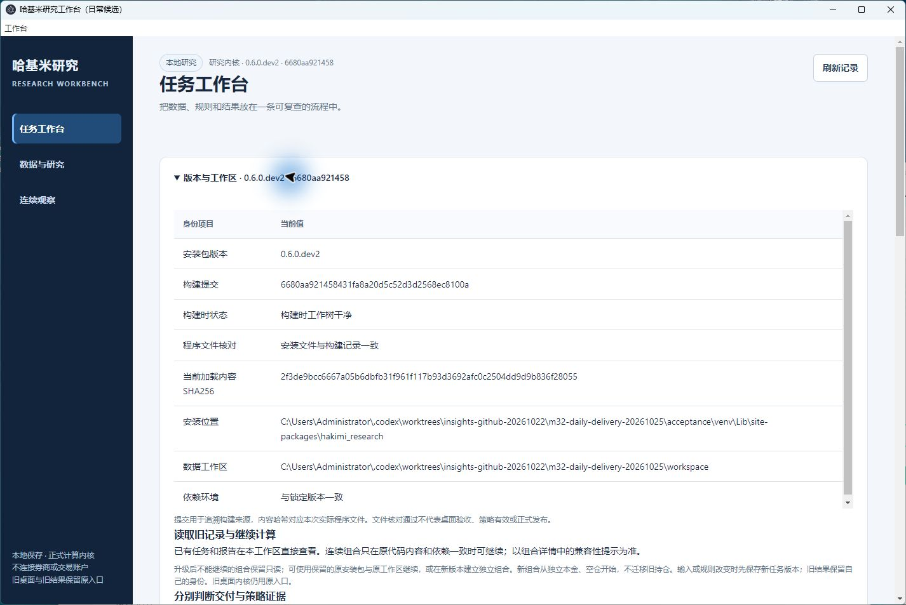
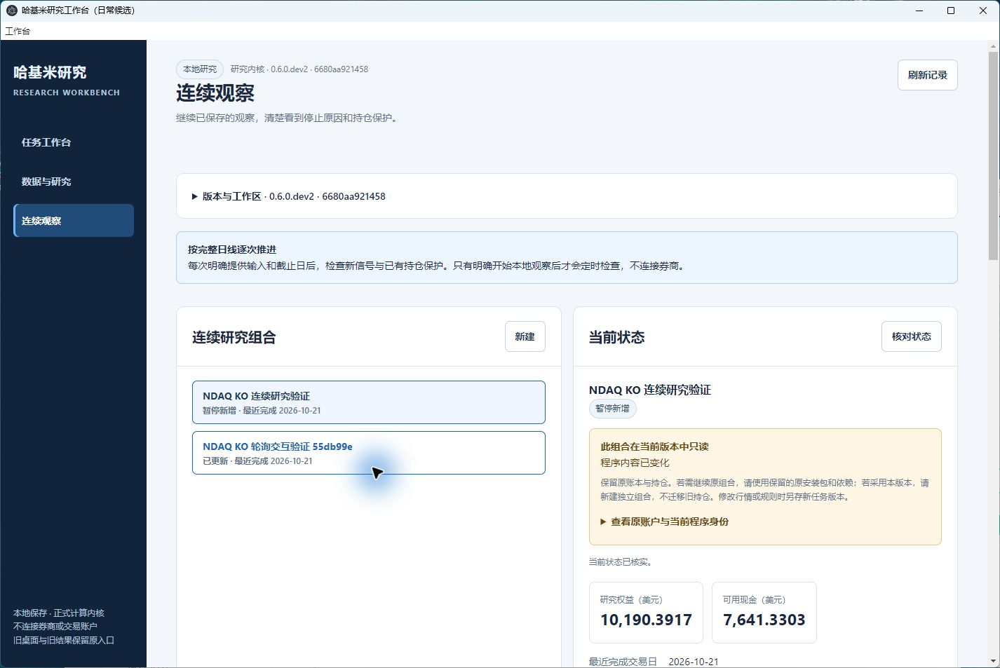
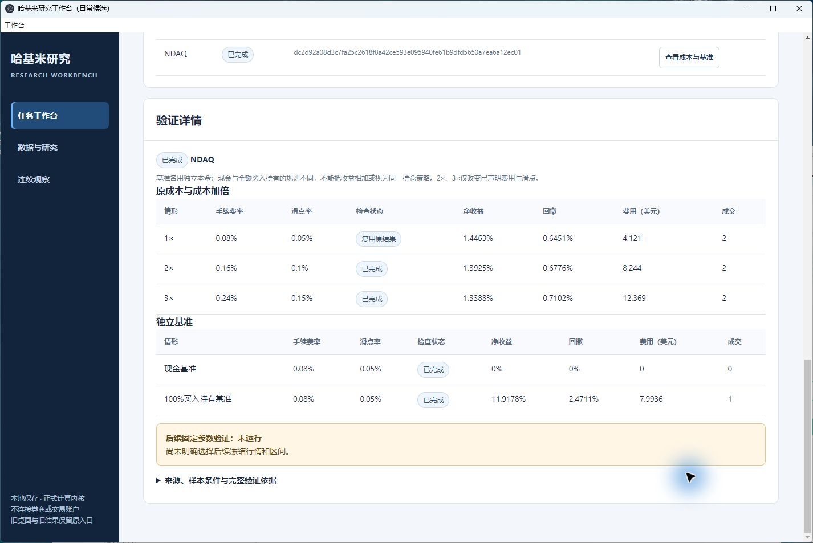

# 日常候选交付验收

日期：2026-10-25，北京时间。运行构建为 CLEAN `6680aa921458431fa8a20d5c52d3d2568ec8100a`，包版本 `0.6.0.dev2`。本说明是后续文档提交，不改变安装包内的构建身份。新 GitHub HEAD 的 CI 在 PR #26 单独核对，不继承 `528181c` 的检查结论。

## 已交付的使用入口

桌面新增 **哈基米研究工作台（日常候选）**，指向同级 `m32-daily-delivery-20261025/desktop/Start-Workbench.cmd`。启动器由仓库工具生成，每次启动检查 wheel、桌面文件、实际安装、构建及依赖身份；同一候选入口使用自己的应用目录。旧快捷方式、旧包与原数据目录不替换。

界面顶部展开“版本与工作区”，可直接看到包版本、构建提交、构建状态、实际加载内容 SHA256、安装位置及数据目录。原连续账户显示原代码与依赖是否匹配；不匹配时保留读取，禁用继续写入，并说明使用原环境或新建独立账户的路径。Git 或文档变化本身不作为账户不兼容的依据。

| 身份 | 精确值 |
|---|---|
| 源码内容 SHA256 | `2f3de9bcc6667a05b6dbfb31f961f117b93d3692afc0c2504dd9d9b836f28055` |
| wheel SHA256 | `2b87b8164cbb722befe3280933d824963a4226a4a497a39e083217cc7f885525` |
| 本地证据根目录 | 与源码工作树同级的 `m32-daily-delivery-20261025` |
| 普通安装 | `acceptance/venv`，非 editable、无 PYTHONPATH、无系统 site-packages |
| 新数据工作区 | `workspace`，读取保留字节的旧记录副本 |

## 验证结果

- 同一普通 wheel：**382 项通过，0 跳过，258.180 秒**；7 项安装工作流通过；包内测试禁止外连。保留原 379 项构建证据，不改签旧回执。
- 针对检查：工作台 Python 13、桌面入口 Python 6、界面 Node 32、桌面入口 Node 6 项通过。它们与安装测试存在重叠，不相加为独立测试总数。
- 从真实生成的 `Start-Workbench.cmd` 打开 Windows 原生窗口，展开版本卡，选择旧 NDAQ/KO 连续账户，核对只读原因和原权益记录。
- 关闭原生候选窗口，确认其进程退出，再从同一入口重开；窗口及本机随机端口均改变，NDAQ 已保存成本报告仍可读取，后续验证继续为“未运行”。
- 补充页面检查使用已有 Chrome / Playwright：1440×960 与 390×844；无页面脚本错误、空白页或框架错误遮罩。首次浏览出现一条资源 404，默认 favicon 地址返回 404；刷新和窄屏检查无相关报错，应用功能正常。Browser 插件未提供，未下载新浏览器。窄屏数据表沿用横向滚动。

## 原记录保全与证据成熟度

原 NDAQ 工作区 156 份、上一日常工作区 230 份、原恢复演练 109 份，共 **495 份既有文件**逐字节 SHA256 不变。新工作区含 236 份副本，页面读取、原生关闭重开及回读后，变化、缺失和新增文件均为 0。原 Documents 源码的 603 行 dirty/untracked 状态原样保留；未对其做提交、清理或重置。

只读核对覆盖 **4 个任务族、6 份运行、2 份成本验证、2 个旧账户**。旧账户因程序内容不同显示只读。本轮没有新增真实 NDAQ/KO 经济运行、行情抓取或研究反馈导入；安装测试中的明确合成计算不作为真实研究结果。

现有 NDAQ、KO 日常结果仍各只有 15 个评估交易日、1 次完整买卖、2 次成交，后续固定参数检查为 `NOT_RUN`。版本卡、报告诊断和说明分别解释工程交付与策略证据，测试通过不代表策略有效。

本机完整回执包括 `acceptance/wheel-acceptance.json`、`browser-qa.json`、`saved-records-audit.json`、`native-acceptance.json`、`preservation-final.json`、`desktop/desktop-manifest.json`。仓库保留[精简验收摘要](research-evidence/daily-delivery-20261025/verification-summary.json)和实际原生截图，完整行情、账本及本机路径清单留在本地。

本候选是已验证的本机使用入口，不是包含全部依赖的公共安装器。未发布 Release、未合并 PR，未接入券商或付费模型，未迁移研究侧数据库。跨年日历、公司行为、前瞻证据和两个项目的关联导航仍按后续阶段推进。

