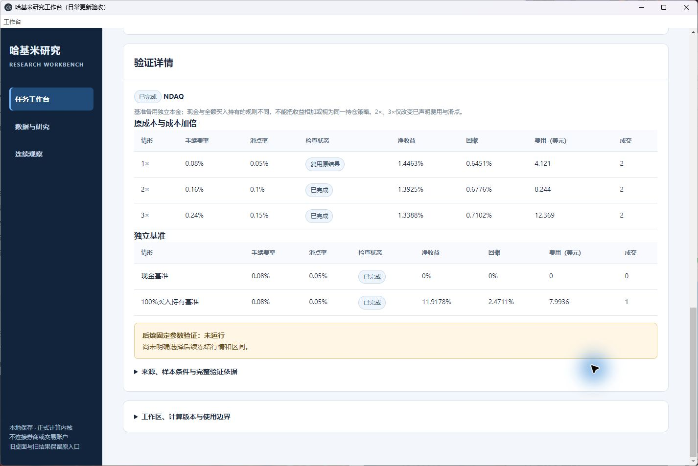

# 第二批：日线更新、诊断与成本验证的实际验收

日期：2026-10-23，北京时间。开发源码提交 `7f61da41eb01ec8666ac6f96dd3b5754d99dfa3e`，功能提交 `beec9c922d99c8da91e425e9f5cb05633205ff6e`。本记录的文档提交另计。

## 先确认上一批 CI

开始改动前核对 PR #26 的提交 `7f8e644fdbff66f095f578d0e819660e59f75081`：11 项检查全部 SUCCESS。对应 [GitHub Actions 39864270233](https://github.com/TheDeadly-cat/hakimi-jiaoyi/actions/runs/39864270233)。这是上一提交的结果，本批推送后的 CI 独立核对。

## 复用的已有功能

复用正式 RAW_UNADJUSTED 日线快照、纽约交易时钟、不可变文件保留、任务家族版本、原研究计算内核、独立基准、报告诊断及持久化操作回执。旧终端抓取器会复权和补值，因此新增公开查询适配层，把真实来源交给已有严格快照检查。原结果比较继续检查费用等可比条件；成本情景单独保存，不放宽原比较条件。

使用入口见 [操作说明](daily-workbench.md)：

1. **数据与研究 → 按需检查股票日线**：检查新增完整日线，审阅历史修订，明确冻结新输入。
2. **数据与研究 → 更新已有任务输入**：保存新版本，保留参数与旧记录。
3. **任务工作台 → 查看结果**：读取样本与风险诊断；点击“验证基准与成本”保存成本矩阵和独立基准。

## 实际来源与任务

公开 Yahoo 原始响应经正常工作台按钮取得，无补造或修改时间。两只股票均从 2026-09-16～10-21 的 26 根日线更新至 10-22 的 27 根完整日线；10-22 常规收盘为 20:00Z。

| 股票 | 实际取得时间（UTC） | 发现的历史修订（10-21） | 新快照 |
|---|---|---|---|
| NDAQ | 2026-10-22T23:33:58.818302Z | high 96.54000092 → 96.55999756；volume 3347938 → 3348600 | `1d502d1e79750ab19b5efa8190e2e8aa602ea4ed12ccfeed0faef5779c596968` |
| KO | 2026-10-22T23:35:26.234344Z | open 93.10500336 → 93.11000061；volume 15133766 → 15152000 | `e94003c3351ead48f1c854506925fcf09cb2e6193dabc390b58836a45385515e` |

NDAQ 原响应 SHA256：`7b718813306a174eb8412e5f52bb553ef9ad237294c6600a5efeee2e79e57a71`。
KO 原响应 SHA256：`37aebce807f53eb34b3f6c7878135efd63c4d39f1271ccaaae9c92a728f4bef6`。

两次检查各发现两处字段差异，均先展示原值和新值，再明确勾选确认并冻结。两项既有双均线任务增加 r0002；逐字段核对，仅改变快照、评估止日和版本编号。双均线 5/10、25% 仓位、3% 止损、6% 止盈、10000 美元本金、0.08% 手续费和 0.05% 滑点保持原样。旧排期任务及其反馈记录不重跑。

| 股票 | 新任务 ID | 新运行 ID | 验证包哈希 |
|---|---|---|---|
| NDAQ | `eb79fea984763a16291f2fafc2623facaa378797a0c48ec53f7aafbbe93012de` | `7871a14c400b274bcc89870eb55964f68acbbd8fb82366ab99184d5311854ca0` | `dc2d92a08d3c7fa25c2618f8a42ce593e095940fe61b9dfd5650a7ea6a12ec01` |
| KO | `f6f4e051d746ed882933ab5e31e32a8351e3123322af58fb37d819bad8b65c89` | `2b71a64b877747dae8b81a184c91a354de2d19277bf5470fdcdfd3037a038fdf` | `fdf56cca6058102a6280e4d53154dfbef4bc3ac370902b259cb21c29249fdacb` |

## 诊断与成本回读

两份结果均只有 15 个评估交易日、1 次完整买卖和 2 次成交。界面明确标注证据不足，不能将该短区间当成统计可靠的策略结论。

| 情景 | NDAQ 净收益 / 最大回撤 | KO 净收益 / 最大回撤 | 手续费（各自美元） |
|---|---|---|---|
| 原成本，复用原结果 | 1.4463% / 0.6451% | 1.4463% / 0% | 4.121 |
| 2 倍费用与滑点 | 1.3925% / 0.6776% | 1.3925% / 0% | 8.244 |
| 3 倍费用与滑点 | 1.3388% / 0.7102% | 1.3388% / 0% | 12.369 |
| 独立现金基准 | 0% / 0% | 0% / 0% | 0 |
| 独立 100% 买入持有 | 11.9178% / 2.4711% | 10.3316% / 1.2993% | 7.9936 |

每份验证新增 4 次情景计算，原成本读取原报告。独立买入持有的仓位和风控规则不同，不可与原策略收益相加。未选择晚于 10-22 的后续行情，后续固定参数验证保留 NOT_RUN；没有将本次运行描述为盲测或未来收益证明。

再次点击 NDAQ 成本验证的操作 `3abde480-c4f9-4f64-90d9-a78f47d88005` 返回 `reused_saved_validation=true`、`action_new_economic_runs=0`。第三次行情检查 `3701876a-7b77-404f-8caa-bbdf9ea6409d` 返回 UNCHANGED，不生成新输入。

## 桌面、安装与保全

使用 Windows 原生 Electron 窗口及普通安装 venv；没有 PYTHONPATH 或 editable 安装。桌面执行 NDAQ 检查、修订确认、冻结，两项研究运行、KO 成本验证及重开后 NDAQ 成本回读。同一服务的临时内置浏览器完成 KO 更新、两项任务改版、NDAQ 成本验证和旧结果阅读，控制台 warn/error 为 0。

窗口启动器只隔离应用配置目录和标题，后端、网页及操作流程来自安装包。原窗口保持打开。新窗口使用独立工作区，复用旧数据、任务、运行及研究依据副本；原有连续账户绑定旧运行版本，留在原工作区和旧窗口中。

- 源码内容身份：`3adcc31e3aba61d838751e2c6a2fccd48487447016a4fbc799e5e6ebb7d825dd`。
- wheel SHA256：`aa8d8c511d11bd9bf70af160aabceb899b8ac97bdc3616c4c9694419a9f51695`。
- 集中检查：53 项 Python、30 项界面检查通过。
- 普通安装完整验收：379 项测试全部通过（292.526 秒，0 跳过），7 项安装流程通过；最终回执见[安装摘要](research-evidence/daily-workbench-20261023/installation-summary.json)。
- 保全核对：原 NDAQ 工作区 156、旧恢复演练 109、桌面副本 135，共 400 份既有文件 SHA256 不变，无缺失。
- 重开核对：本次工作区 230 份文件，关闭并重开、读取保存验证后仍为 230 份，变化、缺失、新增均为 0。
- 只读审计通过两份验证包及 4 份旧运行；审计中禁用经济计算入口，新增经济计算为 0。

## 证据位置与边界

完整本地证据根目录为 `m32-daily-20261023`，与交付源码工作树同级：`desktop-workspace/updates` 保留来源，`tasks/runs/validations` 保留冻结记录，`desktop-record-audit.json`、`preservation-after.json`、`reopen-after.json` 保留审计。安装回执位于 `acceptance-verified/wheel-acceptance.json`，可分发验收包位于 `accepted-verified`。

新桌面入口为该目录的 `desktop-launcher-verified/Start-Daily-Workbench.cmd`。仓库只提交简明验收摘要与截图；完整行情、账本和工作区继续保留本地。

来源保持 IMPORTED_UNVERIFIED。当前公开更新入口支持 2026 年美股常规时段，未覆盖临时休市和其他年份；窗口内公司行为、缺失日线或来源未完成时保留停止/等待原因。此验收不包含订单、模型调用、重新发布研究反馈、数据库迁移、PR 合并或公开发行。
