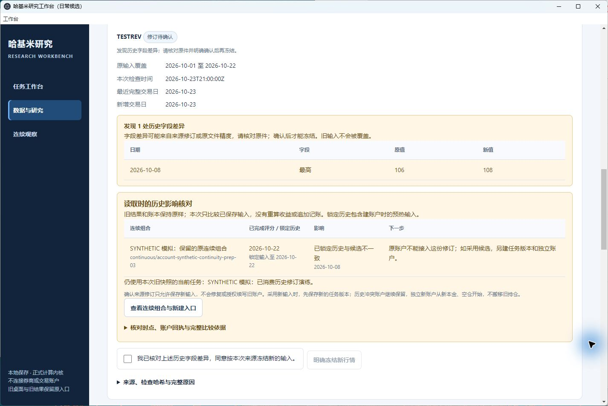
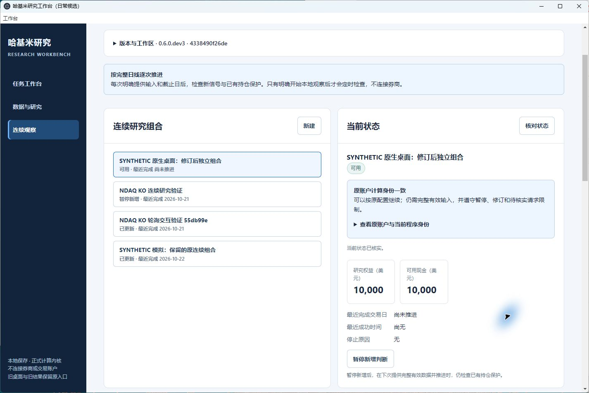
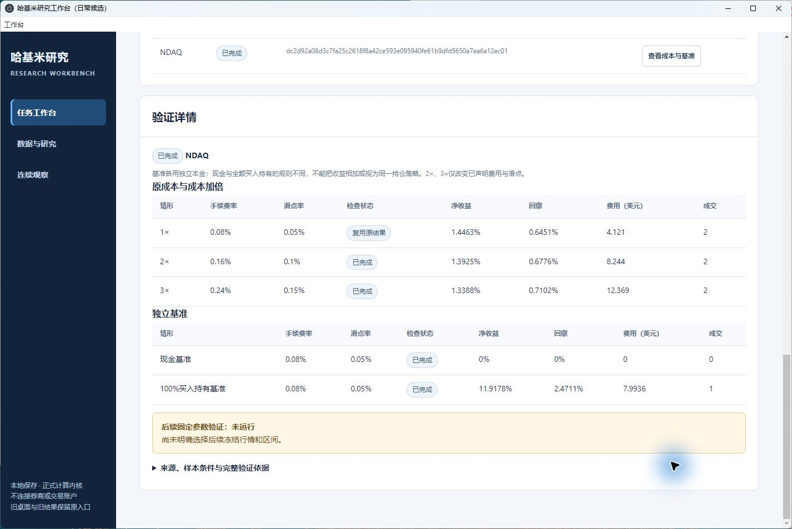

# dev3 原生桌面点击与重开验收

2026-10-25（北京时间）。用户恢复桌面操作后，在已验收的 `0.6.0.dev3`、CLEAN 构建 `4338490f26dec70c79778cd5d1a85a2aaa3474d5` 上完成本轮原生验收。运行源码与安装包未修改，沿用此前 391 项安装测试及 7 项流程结果，没有重建或重跑整套安装。前一[后台验收与延期记录](data-continuity-acceptance-20261025.md)保留，以下为新增证据。

## 实际操作结果

从“哈基米研究工作台（dev3数据候选）”所指的 `desktop/Start-Workbench.cmd` 启动，版本卡显示 dev3、构建 `4338490`、源码内容 `4019649982caff0bcb1e5fa23b6b5aafc848ffd2d27bb42a0ae402193f16a537` 和指定工作区。

| 原生窗口操作 | 实际结果 |
|---|---|
| 查看 TESTREV 修订 | 2026-10-08 最高价 106→108；指出旧模拟组合的已锁定历史受影响 |
| 明确确认并冻结 | 新输入单独保存，旧快照保留；未确认时冻结按钮不可用 |
| 保存新任务版本 | 引导带入原模拟任务、冻结行情和 2026-10-23 止日；保存 r0002，未自动运行 |
| 新建独立模拟账户 | 10000 现金、空仓、尚未推进；不迁移旧账户持仓 |
| 关闭与同入口重开 | 旧候选进程与监听端口退出；重开产生新进程及端口，版本身份不变 |
| 重开后回读 | 新 r0002、新账户、拆股停止说明、2026→2027 合成检查及原 NDAQ 成本矩阵均可读 |

本轮原生仅产生 `freeze_stock_update`、`bind_task_input`、`create_account` 三条保存操作。原模拟账户未推进、未增加回执；之前后台浏览器验证的“修订历史被原账户拒绝”证据继续保留，不冒充本轮又做了一次。

新任务 ID：`369fd3ee339452b60cd02c565f78fb4a893f76962ad52280902cad6856296356`，版本 `r0002-3aa99d237faf4d51a1766b9ca864b8d3`。新账户 ID：`105b475401d2b18d6803d49997053355543c9ed9ed757058ca20d67fc97f0fcb`。保留双均线 5/10、仓位 25%、止损 3%、止盈 6%、费用率 0.0008、滑点 0.0005；新组合总仓位/单标的/最低现金/日亏损模板为 80/50/10/5。

## 保全与版本核对

- 写入前主工作区 349 份文件全部保留原字节，仅新增 17 份文件；原任务版本和原模拟账户账本未变，新增经济运行及运行目录为 0。
- 关闭前后 366 份文件集合及每份 SHA256 完全相同；新任务、账户身份、现金和未推进状态不变。
- 四个旧工作区 731 份文件、候选内原 236 份记录副本、原 Documents 未提交修改状态保持；dev2 原窗口和旧安装继续保留。
- 实际关闭窗口 `17500798`、服务端口 `57571`，其所属进程和监听均退出；同入口重开为窗口 `657824`、端口 `58478`。这些仅是本次运行身份，不是固定启动参数。

新窗口留在原 NDAQ 已保存的成本与基准报告；只读显示 1×/2×/3×、现金和买入持有基准，后续固定参数检查仍为“未运行”，没有新增 NDAQ/KO 经济运行。

未来 2027 案例为明确标注的合成价格与模拟时钟检查，没有伪造真实行情。日历支持边界维持：XNYS 2027 已核实；XNAS 2027 年表未核实仍停止；公司行为账务尚未支持。此次验收不扩展交易或模型权限。

## 可复核证据

[结构化结果与截图 SHA256](research-evidence/data-continuity-native-20261025/verification-summary.json)包含三条操作 ID、冻结回执、账户与任务身份、保全结果及原生截图。截图取自 Windows 工具实际返回的画面，8 张文件哈希各异，原件在本机新证据目录保留。

完整本机证据位于 `C:\Users\Administrator\.codex\worktrees\insights-github-20261022\m32-data-continuity-20261025\native-acceptance-20261025-r1`。后验读取器曾按错误的请求外层结构解析而停止；改为读取已保存请求封套后通过，失败过程不写业务数据。GitHub 最新提交的 CI 仍单独核对，不将此前 b283162 的 11 项通过挪作新提交结果。PR 保持草稿，未合并或发布。
