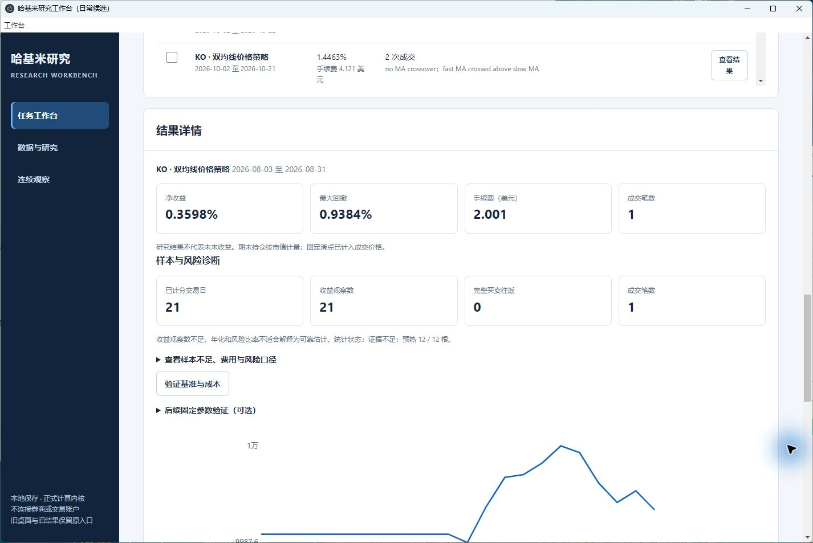
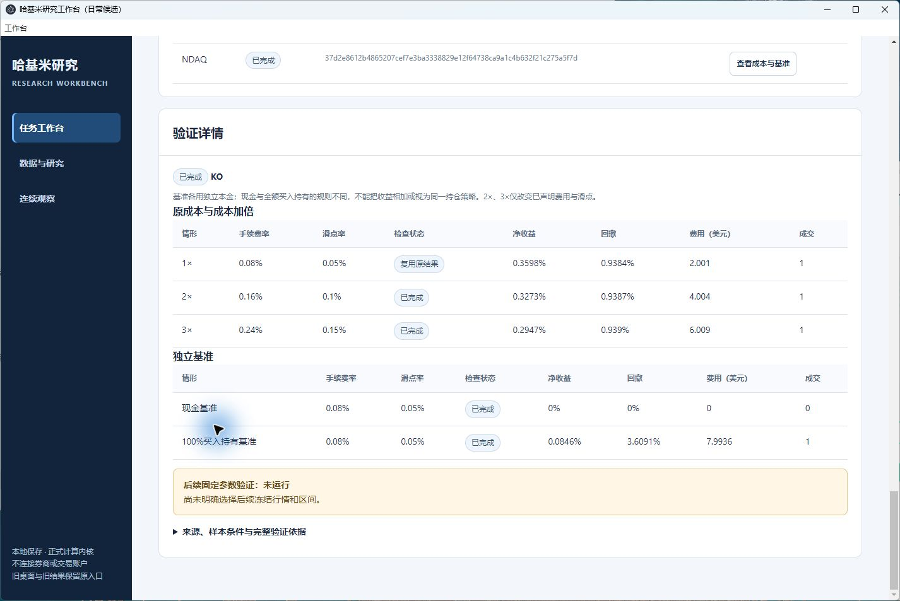
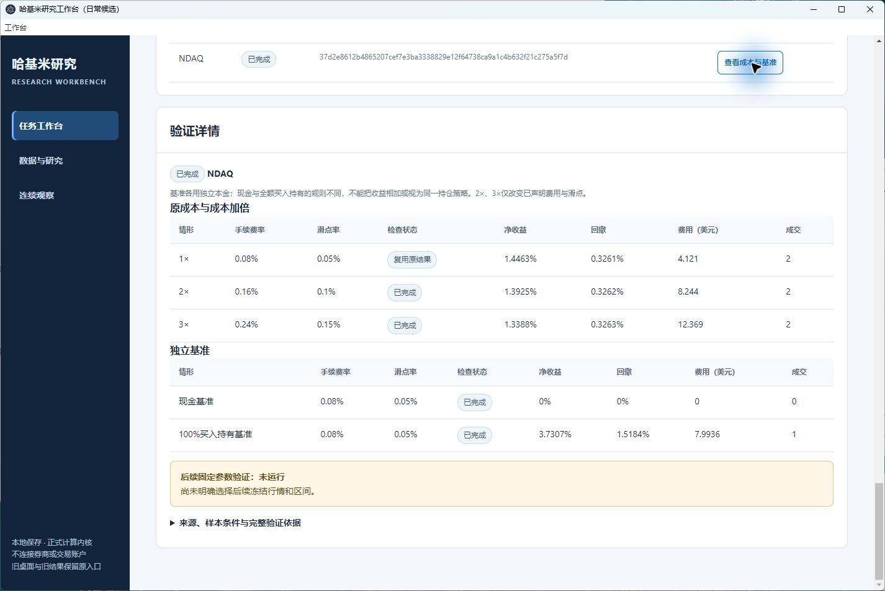
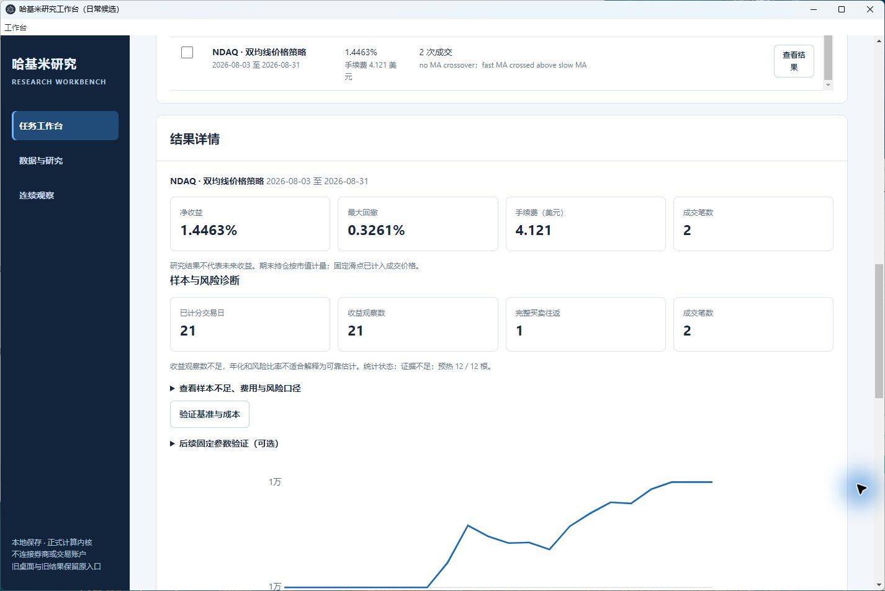

# 固定参数历史隔离回放：实际运行与桌面验收

2026-10-26（北京时间）。按用户选择，先执行历史逐日回放，策略只能收到决策时点以前的价格；本轮不等待四周自然前瞻。先检查已有功能，复用已验收dev3及原任务、导入、运行和成本矩阵入口；产品运行文件未修改。协议与验证工具在正式运行前提交为 `ca99bc35b3f6ebc9892ff9c8bb7533f6e5fcb14a`，结果及验收随后追加。

## 固定约定与数据口径

[封存协议、v1停止及v2历史准入合同](research-evidence/fixed-month-replay-20261026/README.md)固定了8月3日至31日21个交易日，以及7月16日起12日预热。两标的均使用5/10均线、25%仓位、3%止损、6%止盈、10000美元独立本金、0.0008费率和0.0005滑点。1×/2×/3×成本及现金、100%买入持有基准均在同一区间计算。

原来源实际于10月22日取得。v1因调整收盘价差异停止，0次经济计算；v2在独立字段诊断后、任何策略结果之前新增，只允许完整解释的窗口后分红调整，原日期和经济参数不变。源OHLCV仅按既有8位小数规则转换，调整价和后续事件不进入策略输入；旧每日更新守卫未变。原件、STOP、两版约定及工具版本全部保留。

## 实际保存结果

| 标的 | 策略净收益 | 最大回撤 | 成交 / 完整往返 | 100%买入持有净收益 |
|---|---:|---:|---:|---:|
| NDAQ | 1.4463% | 0.3261% | 2 / 1 | 3.7307% |
| KO | 0.3598% | 0.9384% | 1 / 0 | 0.0846% |

两者均仅21个评分日，现金基准为0。NDAQ只有1次完整往返；KO只有1笔买入、没有完整往返，期末按市值计量。策略25%仓位与100%买入持有的仓位、退出规则不同，不能据此宣称策略优于基准；短样本不支持长期收益或可靠年化结论。

新增2份正式历史回放；两个成本包各计算4个新情景，原成本行复用各自新报告，因此合计10次经济情景计算。另有2次明确计数的隔离验证复算，不作为新增产品运行。重复点击KO成本验证返回 `reused_saved_validation=true`、新增计算0。完整身份和各档成本见[结构化验收记录](research-evidence/fixed-month-replay-20261026/verification-summary.json)。

| 标的 | 新运行 ID | 成本验证哈希 |
|---|---|---|
| NDAQ | `e70e16f38033adfff937ef30d6fa43387f80d93532df81d35ccc714be6394f23` | `37d2e8612b4865207cef7e3ba3338829e12f64738ca9a1c4b632f21c275a5f7d` |
| KO | `d3856be786a5133a26e74ad68669caa6240f1b2241284c72855997571a304b8b` | `cf3581d1a96ab9d3c82b3cdd8260f19332eeac8222ecc64594a1e9340c6ff648` |

## 禁止读取未来价格的实测证据

[NDAQ访问记录](research-evidence/fixed-month-replay-20261026/causality-NDAQ.json)与[KO访问记录](research-evidence/fixed-month-replay-20261026/causality-KO.json)各21次策略回调，可见行数严格从12增长到32。所有回调的未来行索引均被拒绝，数值底层容量仅覆盖可见前缀，与完整行情存储不共享；每次收盘后60秒的可用时点早于下一开盘。首个时点为07-31 20:01Z→08-03 13:30Z，末个为08-28 20:01Z→08-31 13:30Z。

观察器没有替换策略算法。两次复算的经济输出与正式报告逐值相同，各原运行6份文件哈希不变。另有合成后缀价格/成交量扰动，证明过去的非空成交、信号和权益不随未来变化，而未来结果确实发生变化。来源合同27项、隔离工具10项定向测试通过；这37项不与原391项安装测试相加。

这些证据覆盖注册Python策略回调的数据边界，不是抵抗恶意反射、文件或网络访问的操作系统沙箱，也不证明全局未见过的数据。参数来源为10月原任务，晚于8月回放；实际来源亦为事后取得，因此不是独立盲测、天然前瞻或事先8月交易承诺。

## 原生桌面与保全

实际使用 `m32-fixed-replay-20261026/desktop/Start-Workbench.cmd`：核对dev3/CLEAN 4338490/源码401964…及独立工作区；查看固定NDAQ参数；从原生窗口分别点击两项新历史任务“运行研究”；核对KO结果及两标的成本矩阵。输入导入、任务创建和首次成本计算经现有工作台API完成；KO重复验证由原生点击完成，没有新增计算，不把API操作冒充原生点击。

关闭窗口526158后，其所属进程及60205监听退出；从同一入口重开为窗口526146、56063端口，重新读取保存的NDAQ八月结果及两份成本记录。关闭重开前后440份文件的集合和每份哈希完全相同。原dev3的366份文件、独立副本内原366份文件、其他731份历史文件及原Documents未提交状态保持；原安装包与88个运行文件未变。未重建安装包。

首次遮挡时曾取得非目标画面，该画面未作为验收证据；激活目标后重新观察。一个可访问性元素没有缓存坐标时重新观察后点击可见控件，没有重复运行研究。5张实际原生截图的哈希各异并保留原件。

本机完整原始来源、报告和回执根目录：`C:\Users\Administrator\.codex\worktrees\insights-github-20261022\m32-fixed-replay-20261026`。仓库提供协议、工具、摘要、隔离证据及截图；完整原始行情和工作区在本机保留。

打开该独立入口，在任务工作台查找“KO / NDAQ 历史隔离回放 · 2026年8月 · 固定5/10”，从“已保存结果”读取。成本页面下方“后续固定参数验证：未运行”指尚未选择该报告之后的另一段区间；本次八月历史报告已完成。原10月基线后的自然前瞻区间仍未执行，不能把本次回放改签为那个区间。

本次提交的最终CI在[草稿PR #26](https://github.com/TheDeadly-cat/hakimi-jiaoyi/pull/26)按精确HEAD单独核对，不沿用40f2d36的旧结果；未合并、未发布Release。

