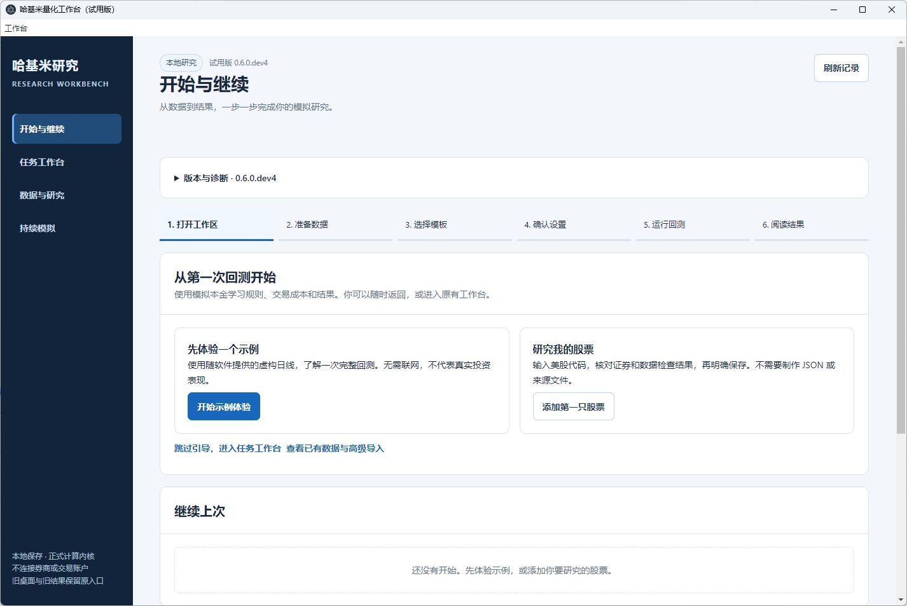
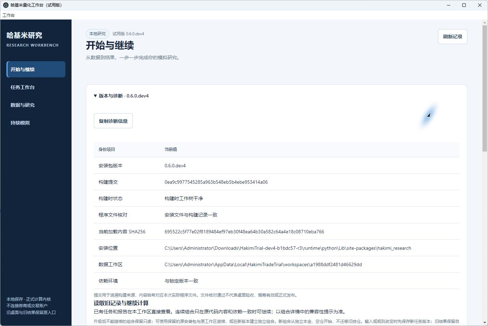
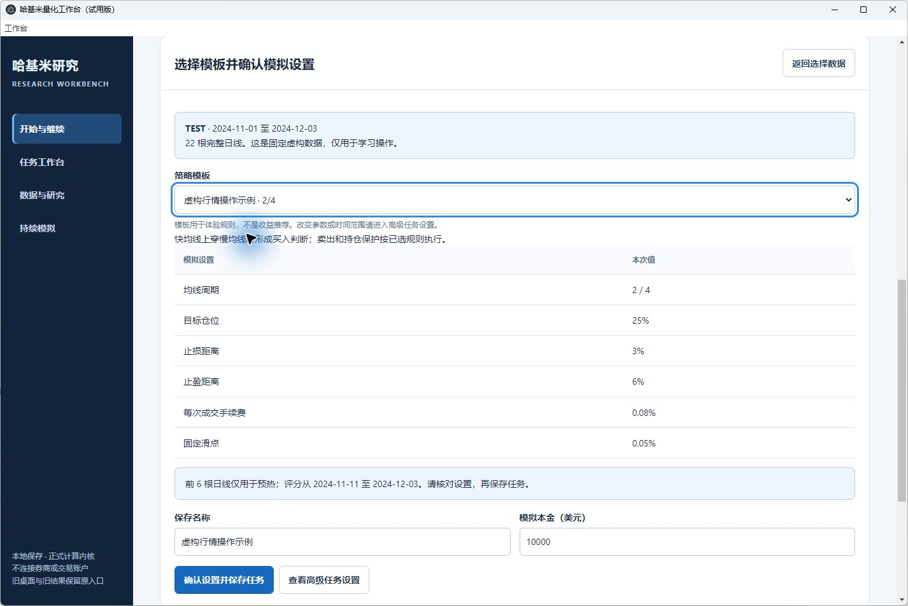
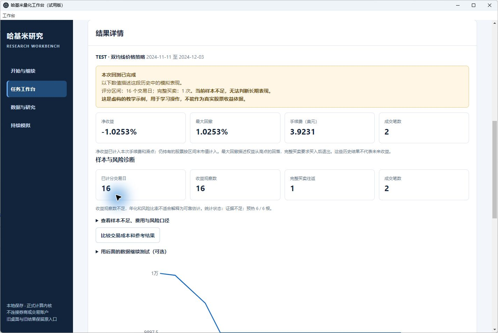
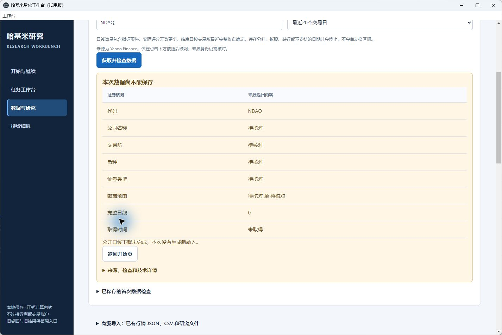
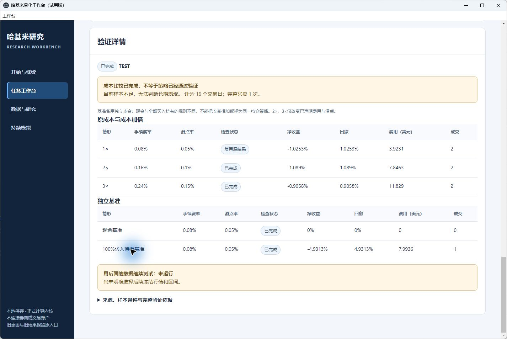
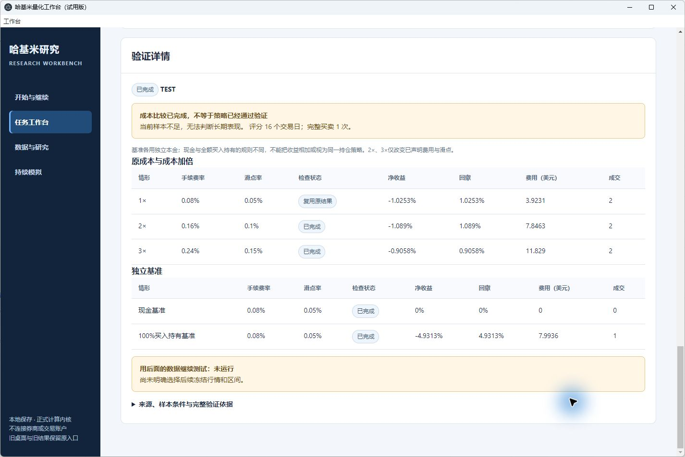

# dev4 首用试用交付证据

结论和使用边界见[首用验收](../../first-use-acceptance-20261026.md)。本机示例、成本与关闭重开通过；**真实股票首次在线获取未通过**，两份 NDAQ STOP 保留。干净新机和独立真人试用由用户另行安排。

[结构化总览与文件哈希](verification-summary.json)绑定产品 `0ea9c99`、桌面 `b1bdc57`、r3 ZIP及实际任务/运行/停止记录。36份复制的回执和截图与本机原件逐字相同；这里只保存必要证据，没有将188 MiB运行时包或原用户数据加入Git。

- [最终试用包构建与ZIP核对](windows-trial-build-summary-r3.json) · [运行时来源](windows-trial-runtime-sources-r3.json) · [私有Python探针](windows-trial-probe-r3.json)
- [普通安装验收](installed-wheel/wheel-acceptance.json) · [精确测试范围](installed-wheel/test-scope.json) · [源码构建身份](installed-wheel/source-build-identity.json)
- [ASAR真实Electron回归](asar-fix-validation-r1.json) · [物理路径修复回归](physical-path-validation-r1.json) · [保留的r1失败](native-startup-failure-r1.json)
- [42文件首轮重开](native-workspace-reopen-r1.json) · [46文件最终运行身份和基线](native-workspace-before-final-reopen.json) · [46文件最终重开](native-workspace-final-reopen.json)
- [旧记录与Documents保全](preservation-check-r2.json) · [用户安排的后续试用](user-delivery-scope.json)
- [实际复制的诊断](native/r3-copied-diagnostic.json) · [只收到HTTP响应头的独立诊断](native/r3-source-request-diagnostic-r1.json)
- [已安装浏览器验证与错误恢复](installed-browser-r2/result.json) · [不支持的文件](installed-browser-r2/unsupported.json.png) · [损坏JSON](installed-browser-r2/malformed.json.png) · [窄屏](installed-browser-r2/05-narrow-ready.png)

原生窗口截图如下。它们来自实际工具图像；没有使用网页截图替代桌面，也没有修改图像内容。

