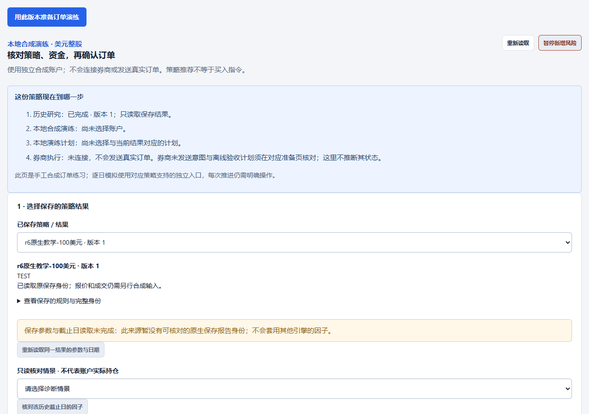
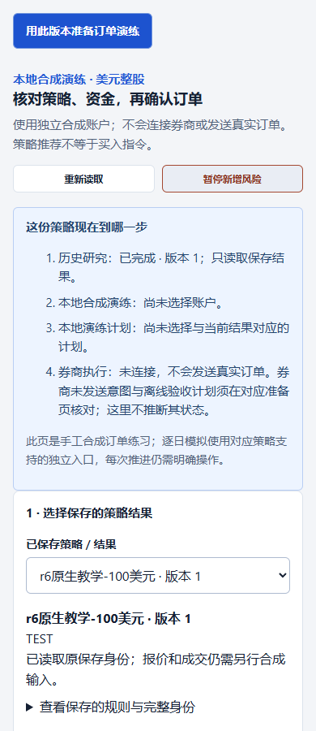
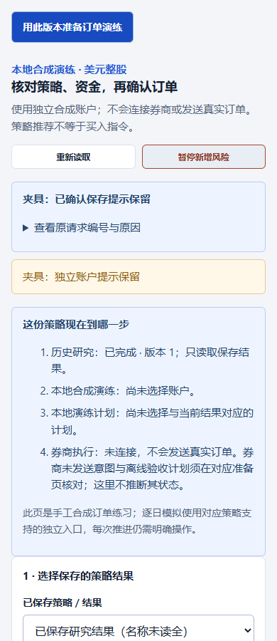

# r6 原生观察后的流程提示修复

r6 原生操作发现：教学资料准备成功后仍显示“正在处理”；保存任务后仍显示“正在选择策略与本金”；新完成结果直接进入订单演练时，绑定和本金正确，但来源下拉框为空、任务名称缺失。

本次仅修复展示状态。教学的有效成功回执替换处理中提示，保存和恢复记录更新阶段文案；独立读取失败提示保留。订单演练缺少当前来源名称时，只读取精确的 `runs/<id>`，核对路由、运行、任务及报告哈希后补名称。读取失败、身份不符或 UNKNOWN 时仍保留原绑定，并明确显示“名称未读全”。迟到响应不会改选另一份结果。

## 身份与提交状态

- 验证基线：`e9e46fcd80b46f9c7ddf0e9453a1220c9c2bbbf8`；独立分支 `codex/native-r6-flow-fixes-20261108`。
- **验证执行时**：六个源码/测试文件尚未提交，准确字节由 [validation-summary.json](validation-summary.json) 的 `source_sha256` 绑定；原审查状态为 `READY_FOR_ROOT_REVIEW_NOT_COMMITTED`。
- **本地交付**：审查通过后，将这六个文件与本证据目录一并提交。包含本目录的 Git 提交是交付身份；最终提交号及 clean 状态另由提交回执报告。验证时的“未提交”状态不改写成提交后的验证。
- 原 `0.7.0.dev3 candidate-r6` 仍绑定上述基线，**不包含本修复**。原包、原生验收记录和失败观察均未改动；本次不构建或发布替代包。

## 验证

| 检查 | 结果与范围 |
|---|---|
| 修复前只读复现 | 三种陈旧展示均复现；仅更新精确来源目录即可恢复名称，绑定不变 |
| 定向检查 | 118 通过，0 失败，0 跳过；覆盖首用、工作台、订单演练及已有用户路径 |
| 新结果入口 | 当前结果不在旧目录时，读取原报告名称；拒绝身份不符/UNKNOWN；A→B、清空、迟到目录均保持准确选择 |
| 实际组件渲染 | Playwright，1280×900 与 390×900；页面非空、无覆盖错误、无控制台错误或外部请求，窄屏无横向溢出 |
| 失败路径 | 名称读取失败时，下拉框仍选中原记录，绑定、本金、保存成功提示和独立错误提示保留 |
| 保存数据保护 | 新 TEMP 内复制 15 个已保存研究文件，只读投影；副本和原保存范围哈希不变，0 新经济计算、0 原工作区写入 |

命令：在 `outputs/python_quant_bot` 下使用已有 Node/Playwright 环境运行：

```text
node --test exchange_terminal/static/terminal-first-use-ui.test.js exchange_terminal/static/terminal-quant-ui.test.js exchange_terminal/static/terminal-execution-ui.test.js
```

Browser 插件不可用，使用已有 Playwright；未安装依赖。详细日志及原始复现/渲染回执保留在本机证据目录，仅其文件名、SHA-256 和必要摘要纳入仓库。原完整数据与投影未复制入仓库。目录文件哈希见 [artifact-sha256.json](artifact-sha256.json)。

## 失败与限制保留

本次渲染是实际组件及保存报告副本的验证，**不是完整原生程序复验**，也没有再次运行研究。名称读取失败是保留的测试场景，不得解释为报告丢失或通过重跑修复。该 core 引擎原有的“因子解释暂不支持”提示仍保留；本修复不扩展因子能力、交易权限或任何真实交易行为。

后续独立审查项：core 教学来源目前以黄色“保存参数与截止日读取未完成”提示其不支持原生因子解释，容易与临时读取故障混淆。本批不改变这段能力提示，也不套用其他引擎的因子来消除警告。

## 截图






