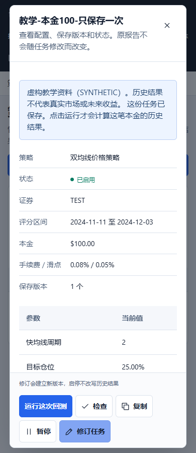
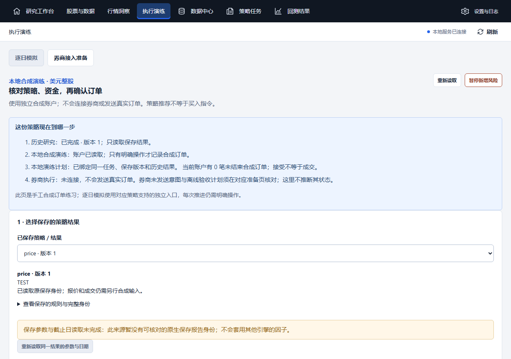

# 新手流程：源码整合与验证

本批从 `76c0522eb12ad2c3b6adb506eca56bcefd5ae75b` 继续，目标是让用户完成“选资料 → 选策略和本金 → 看懂保存结果 → 继续同一策略的本地演练”。这是源码交接，不是新安装包或完整首用验收。全部 U01–U12、A01–A20 仍见[整改清单](../../novice-simplification-backlog.md)。

## 用户可见变化

- 结果首屏显示初始本金、期末总资产、净变化、区间收益和最大回撤，现金与持仓分开。原终端百分点与核心比例分别处理；缺失保持未记录，费用不重复扣除，没有平仓回合不显示伪胜率。
- 首次使用突出“用示例体验一次”；先准备一份虚构资料，再选择本金、保存一个任务、明确运行。返回保留草稿，继续原任务保留虚构提示并可直接运行；已有结果按原报告编号读取，多份由用户选择。
- 策略卡先显示三个教学模板，可展开九规则；显示机制、失效条件、实际因子和能力。量价趋势提前注明不支持本地模拟时钟；不把规则匹配当作收益排名。
- 原策略本金随任务版本和资料币种冻结，并传入真实计算包装器；演练同时显示研究本金与账户资金。整股购买检查含预留、费用和资金底线，小本金不足时提前说明。
- 历史资料可先核对来源、证券、日期和限制，再明确另存到当前工作区。未知请求仅查询原编号；原资料和认证等级不变。没有受支持资料时可返回教学入口。
- 同一工作区保存策略版本、报告、演练账户和计划的精确引用。重新打开先读取原件；缺失或错配保留原编号，不自动运行、下单或恢复权限。
- 本地演练的停止回执显示剩余持仓、挂单、预留资金和计划。停止成功后读取失败仍保留成功事实，未知余额不补零；恢复不自动撤单、清仓或发送旧请求。

## 证明范围

| 范围 | 证据 | 能说明什么 |
|---|---|---|
| 收益卡 | [U01](u01-component.json) | 实际组件及产品样式，1280/390，合成盈利/亏损、键盘与缺失字段 |
| 原报告只读投影 | [读回记录](core-old-report-readback.json) | 仅复制旧隔离虚构工作区到新TEMP；原件和复制件30文件不变，0新经济运行 |
| 首用准备与草稿 | [U03页面](u03-first-use-page.json) | 实际 `/quant/` 与HTTP服务；1输入、0任务/运行，切页保留草稿，刷新只读 |
| 保存后继续 | [U03保存页](u03-saved-task-page.json)、[源码身份](u03-continue-source.json) | 实际1280/390页面保存本金100并重开同一任务；1输入、1任务、0运行，直接运行入口和虚构提示可见 |
| 策略说明 | [U04](u04-strategy-component.json)、[对应哈希](u04-source-hashes.json) | 真实诊断模块与虚构输入，3/9目录、能力限制、1440/390键盘检查 |
| 本金 | [U05专项](u05-targeted-handoff.json) | 64项Python、82项界面专项；后续接线修改文件由最终完整门禁覆盖 |
| 历史资料复制 | [U06](u06-history-copy.json)、[对应哈希](u06-source-hashes.json) | 实际组件→真实helper→新TEMP→关闭后重建reader，原字节不变；1输入、0任务/运行 |
| 状态引用 | [U07子范围](u07-component-handoff.json) | 109项界面、10项Python；工作区绑定、并发版本、幂等与只读恢复 |
| 停止剩余状态 | [U08](u08-stop-handoff.json) | 39项界面、26项Python；1280/390键盘、缺快照与停止后读取失败 |

这些专项报告保持生成时的源码哈希与范围；U05/U08中的部分文件后续接入U07，不能把旧专项日志冒充最终提交验收。[原始凭据对应表](artifact-origins.json)记录逐文件原件哈希。浏览器插件不可用，本轮使用已有本地 Playwright；没有安装新的浏览器依赖。

最终冻结源码的[完整检查](verification-summary.json)已通过：**818/818后端、555/555桌面、15/15打包、4/4检查脚本**，0失败/跳过。2,164项输入的[前置哈希](final-inputs-before.json)与[后置哈希](final-inputs-after.json)完全一致。[完整执行结果](final-gate-summary.json)、[环境](final-gate-environment.json)、[后端日志](full-terminal.log)、[桌面日志](full-desktop.log)与[首轮失败](first-gate-summary.json)分别保留。因子复核和同窗补证的两个DOM测试实际启动浏览器并进入断言；未删除或跳过旧测试。

主页面的[两地址与重启验证](u07-main-reopen.json)另行通过：复制既有虚构核心报告到新TEMP，明确创建一个合成账户与一个本地计划，浏览器明确保存4次选择；在1280/390页面刷新、更换地址、关闭后台并重开后，恢复同一报告、账户和计划。重开0 POST、0新经济运行、0新任务，原30文件与关闭后的整个演练数据库字节不变，完整账本一致。待核对状态仍保留，未自动恢复权限。离开数据页的一次权限收回POST单独记录，不是教学准备或研究。真实页面范围为核心虚构报告→本地手工演练；原策略逐日模拟、券商计划恢复本轮仍以服务/控制器测试为依据。

GitHub CI另按推送后的精确提交核对并记录在PR，不以旧76c0522的CI174替代本批CI。 [Git字节核对](git-input-binding.json)确认本批修改源码及证据均与暂存内容一致；2,164项本地测试输入中，2,159项逐字节一致，另5个未修改的父提交文件仅有本机CRLF与仓库LF差异，父提交内容未改。未调整这些历史文件或全局Git设置。

## 保留的失败与未完成项

- 首用页面早期版本发现专业面板移动后的旧DOM定位错误，已修复；另有测试等待隐藏弹窗/异步动作的断言问题。原外部证据目录保留各轮失败，不覆写。保存后导航取消在途只读连接的Windows 10053记录另行保留，不能计为业务动作或经济运行。
- 原审查报告中的两项 Chromium 缺失失败保留其历史结论；本机后续桌面检查需真正启动浏览器并进入因子、补证DOM断言，不能把旧失败改写成通过。
- 第一轮完整检查实际运行818项后端测试，其中旧测试仅期待成功编号，未接纳新增的财务辅助读取提示，1项失败；已改为同时验证原编号、读取提示和仅一次运行。该测试原有“版本不符不得运行”断言保留，5项定向重测通过。另一次定向命令因运行目录错误未加载测试，换到终端测试目录后通过。首轮检查期间还补了演练账户清单接线，所以该轮不能作为最终源码验收。
- 两地址页面的早期外部测试把折叠编号当作可见文本、把离页权限收回当作业务写入，或比较仍打开的SQLite WAL/SHM与重开后的文件；这些失败保留。最终比较双方后台关闭后的完整文件以及同一账本，仍要求原编号、0自动业务动作和原件不变。
- U06复制链使用31日虚构测试资料。真实留存NDAQ仅完成只读核验，尚未执行本轮复制；其20日数据不能满足原九规则至少82日要求。TSLA来源及公司行为资料阻断保持。
- 当前Windows候选仍为 `0.7.0.dev3 r5 / b642227`，ZIP未更新；新包、原生完整链、独立无源码非管理员Windows、至少3名独立新手均待完成。没有把组件浏览器测试当作这些验收。
- 券商生产派发、授权检查、worker/transport、价格费用事实、OpenD兼容仍有工程工作；不是“只差授权”。本批没有外部行情、模型、真实账户或订单调用，没有合并PR或发布Release。

旧Documents、旧包、历史报告、UNKNOWN和T3保持原身份；冻结研究内核和原策略公式未改。

## 实际页面

继续同一虚构任务（390宽）：

后台关闭重开后读取原本地计划（1280宽；原策略因子不适用于核心报告时继续显示限制）：

