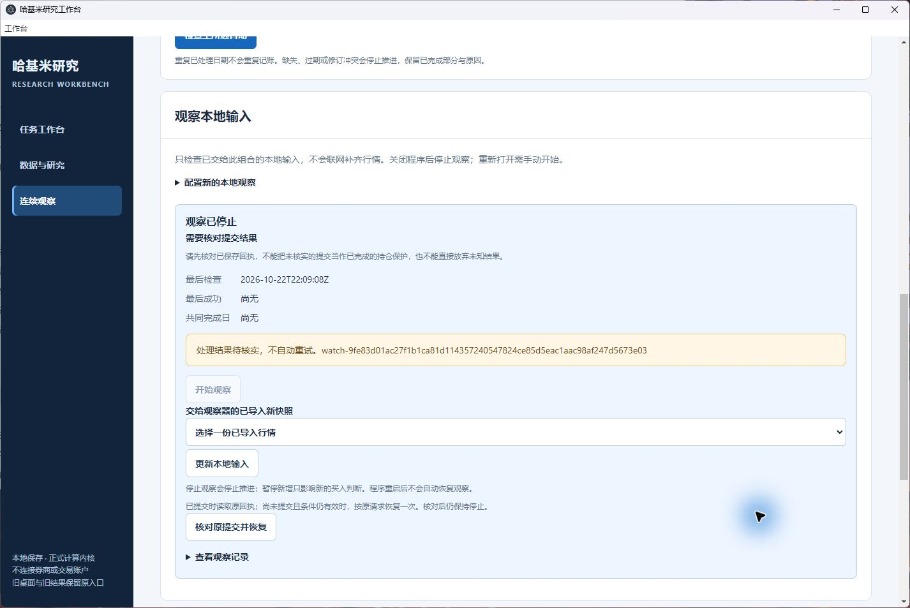
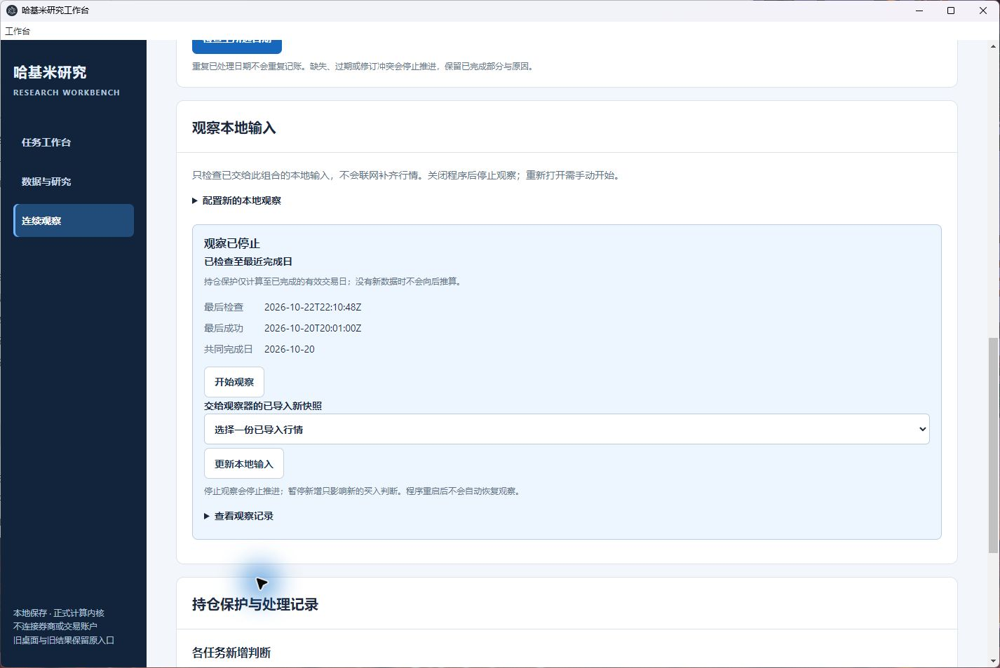

# 观察中断后的显式恢复

日期：2026-10-23。实现提交：`2036fdb66edd00a884ba2137255a042017b40802`。本次处理候选收尾中的恢复入口、普通安装与使用说明；此前 NDAQ 真实研究反馈已完成，本次未重复运行或导入。日常行情更新、诊断界面和独立引擎对照留在后续批次。

## 问题与修复

原界面在重开后遇到待核实提交时禁用“开始观察”，却没有核对原提交的入口。另一个实际中断窗口是请求及 pending 指针已经落盘，而状态文件还没有写入操作 ID。

现在在“连续观察 → 原研究组合 → 观察本地输入”提供“核对原提交并恢复”：

- 已记账时验证并读取同一操作 ID 的原回执，不增加流水。
- 尚未记账且输入、控制及账本位置仍有效时，按原请求和原 ID 恢复一次。
- 输入过期或控制/账本位置已变时保留原请求，进入人工复核。
- 无法核实或请求损坏时继续显示未知状态，不允许直接开始或放弃未知提交。

重开状态从持久 pending 指针核对，覆盖状态文件来不及更新的窗口。共享账本在写事务内再次核对预期收据头；同 ID 已有回执仍优先复用。恢复不启动观察线程；只有之后明确点击“开始观察”才会继续检查。

## 验证及身份

定向检查：Python 27 项通过，界面 26 项通过。新增界面用例修复前复现失败、修复后通过。Python 首次合并检查有一项测试断言放错位置，修正断言后新进程重跑 27 项通过；没有忽略失败项。

普通安装最终回执为 PASS：仓库外 357/357 项通过，零失败、错误或跳过，七项安装流程通过；非 editable、未用 PYTHONPATH、未用系统 site-packages。wheel SHA256 `cde55fa3cb5626ccee0624e362ad1f0a715c1b46a591e7bd1fa11f70567c4954`。全部安装检查只绑定上述源码提交和实际 wheel，不把后续文档提交视为另一个已构建安装包。

独立 Windows 演练使用普通安装的正式包，来源代码身份 `3b416283b23eb9f965770daa8b988b630cbe31c209b07c9927d7a542018acbf1`，构建 Git 状态 CLEAN。测试资料、日历、价格和账户均为 `SYNTHETIC_TEST`。通过普通 Workbench API 准备四组资料，在独立子进程的事务边界实际退出；这一步不冒充 GUI 创建。

| 场景 | 实际交互 | 原账本序列 → 结果 | 保存结果 |
|---|---|---|---|
| 已记账后进程退出 | Windows 原生窗口点击恢复 | 1 → 1，原账本头不变 | CURRENT，pending 清空，观察停止 |
| 未记账前进程退出 | 同服务浏览器点击恢复 | 0 → 1，仅原操作 ID | CURRENT，pending 清空，观察停止 |
| 未记账，输入过期 | 浏览器恢复、填写理由并明确放弃 | 0 → 0 | 先人工复核，再 STOPPED；原请求及处置记录保留 |
| 未记账，账户暂停已改变账本头 | 浏览器点击恢复 | 1 → 1，暂停回执和账本头不变 | PENDING_REVIEW_REQUIRED，原 pending 保留 |

四组原请求文件 SHA256 一致；四次恢复各有一份成功的工作台动作回执，过期分支另有一次处置回执。没有 `start_watch` 操作或新研究运行。浏览器刷新后仍停止；随后正常关闭整个演练 Electron 和服务，核实旧进程退出，以同安装包和同演练工作区重开，原生窗口继续显示已恢复组合及“观察已停止”。浏览器捕获的错误/警告日志为空。一次自动等待使用了错误的提示文字，随后读取实际成功提示验证；没有再次提交操作。

独立只读核对 54 项通过，SQLite 以只读模式读取；真实 NDAQ 工作区基线 156 份文件和结束时 156 份文件的字节 SHA 全部一致，无新增、修改或缺失。精简身份见 [verification-summary.json](verification-summary.json)。完整回执、故障演练原件、测试日志、安装目录和截图位于仓库外 `m32-recovery-20261023`，不将真实行情或研究侧数据库复制到仓库。

### 原生界面证据

恢复前：“开始观察”禁用，新入口可用。

恢复后：原回执已核对，观察仍停止。

## 安装与使用

按[正式工作台与版本入口](../../workbench.md)将新候选 wheel 安装到独立环境，显式指定工作区。文件名同为开发版本 `0.6.0.dev1`，需按验收回执中的 wheel SHA256 和来源提交区分，不能只看版本号。

本机演练入口在外部 `desktop-drill/Start-Recovery-Drill.cmd`，复用原有 Electron 程序；仅隔离 app 名称、用户配置目录和初始窗口标题，实际页面与后台来自已安装 wheel。不是独立便携发行包，不替换旧桌面快捷方式。演练窗口中的任务名称均含“合成恢复演练”。

原 `166e18e` 安装及真实研究数据保持原样。连续账户绑定原代码/依赖身份；新包不会给旧账户改签，旧账户续写仍需要匹配的原运行环境。新修复的中断演练使用新账户。不存在自动升级旧账户或更换未知提交操作 ID 的步骤。

## 已知边界

- 本次验证旧进程已终止后重开的单服务流程；跨进程同时运行同一工作区的观察线程不在本次验证范围内。恢复不会停止另一服务里的线程。
- 指针或请求损坏会保持未知并阻止开始。观察配置或工作台绑定文件本身损坏时，仍需先检查保留文件，不能保证该条观察能在所选账户下正常展示。
- 通用工作台其他未知操作继续保留原锁定规则，本入口不处理无关任务。
- 这些是软件恢复检查，不是实际行情收益研究或策略有效性证据。未调用模型、券商、订单或研究接收端；未合入 main、未发布 Release。
